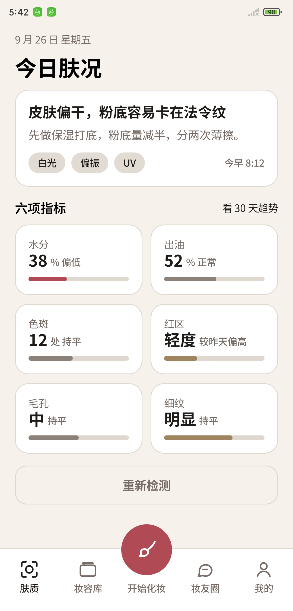
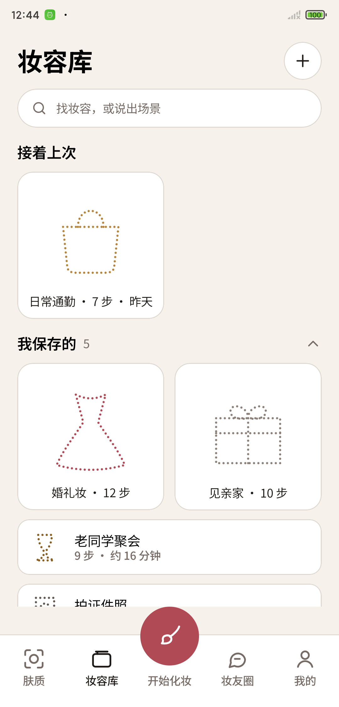
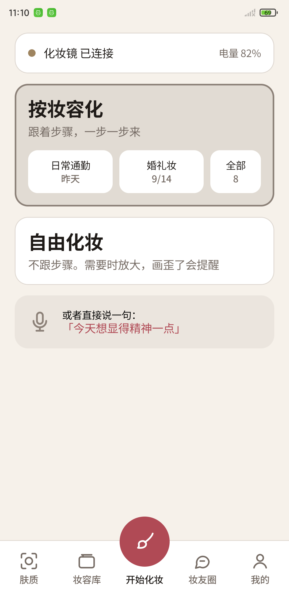
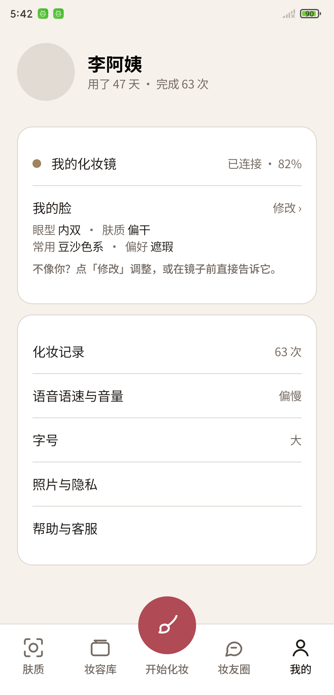
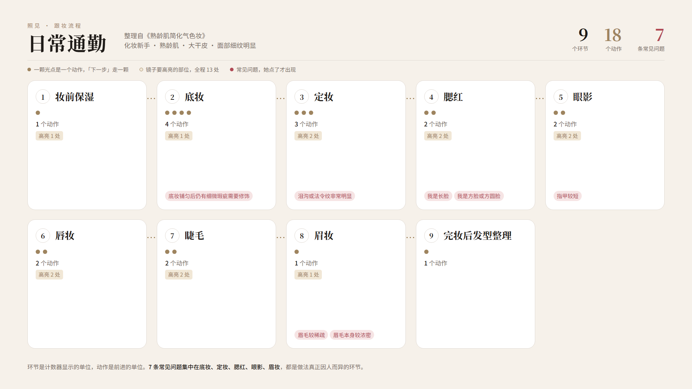

# 照见

面向熟龄女性的智能化妆镜。镜子提供真实镜面、可调补光与摄像头，手机端负责人脸识别与实时引导，覆盖妆前（妆容库、肤况）、妆中（分步引导、实时纠偏）、妆后（点评、分享）。

本仓库只发布安装包与说明，源码不在这里。

## 下载

安装包在 [Releases](../../releases) 页面。

需要 Android 8.0 或以上。首次安装时系统会提示「未知来源」，按提示允许即可。

## 这一版能做什么

- **肤质**：当日肤况结论与六项指标，三种光源切换
- **妆容库**：六套妆容，按使用频率分层展示
- **开始化妆**：按妆容跟练，或自由化妆
- **跟妆引导**：日常通勤、见亲家、婚礼妆三套可以一步步走完，每步给出当前动作、镜面要高亮的部位，以及因人而异时的常见问题
- **妆友圈 / 我的**：同龄人的妆容分享，以及它对你这张脸的判断与修改入口

## 这一版还不能做什么

摄像头与镜子硬件尚未接入，跟妆引导里的镜面画面是占位图。实时纠偏、语音播报、肤质检测的实际测量都还在开发中，界面里的数据是示例数据。

## 界面

| 肤质 | 妆容库 | 开始化妆 | 我的 |
| --- | --- | --- | --- |
|  |  |  |  |

## 跟妆流程

三套妆容的步骤整理自公开的熟龄肌妆容教学视频，逐条核对来源后录入知识库。每个环节包含若干个动作，动作按顺序播报；镜面高亮标出当前要处理的部位；常见问题只在用户表示自己属于那种情况时才出现，不会念给所有人听。

| 妆容 | 环节 | 动作 | 镜面高亮 | 常见问题 |
| --- | --- | --- | --- | --- |
| 日常通勤 | 9 | 18 | 13 | 7 |
| 见亲家 | 12 | 19 | 14 | 4 |
| 婚礼妆 | 15 | 23 | 20 | 1 |

见亲家与婚礼妆的流程图在 [flow](flow) 目录下。

## 授权

应用内置思源黑体（Noto Sans SC），遵循 SIL Open Font License 1.1。
